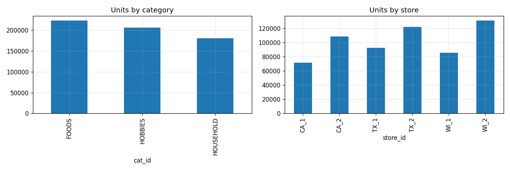
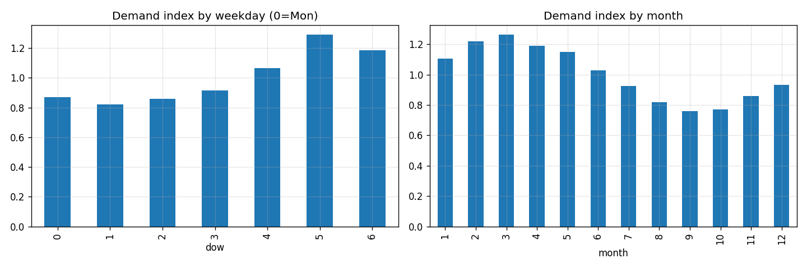
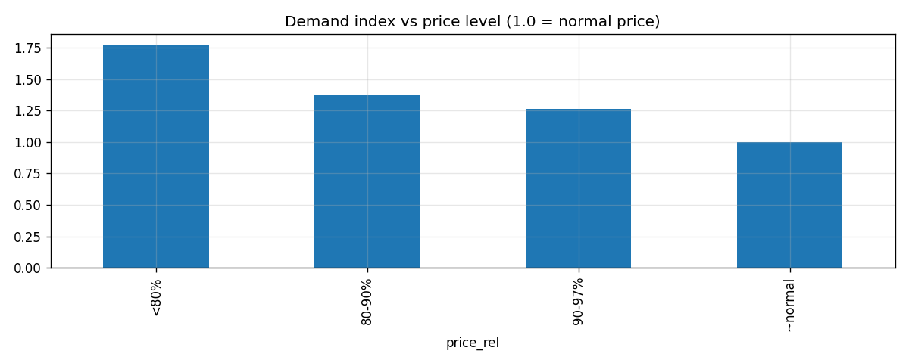
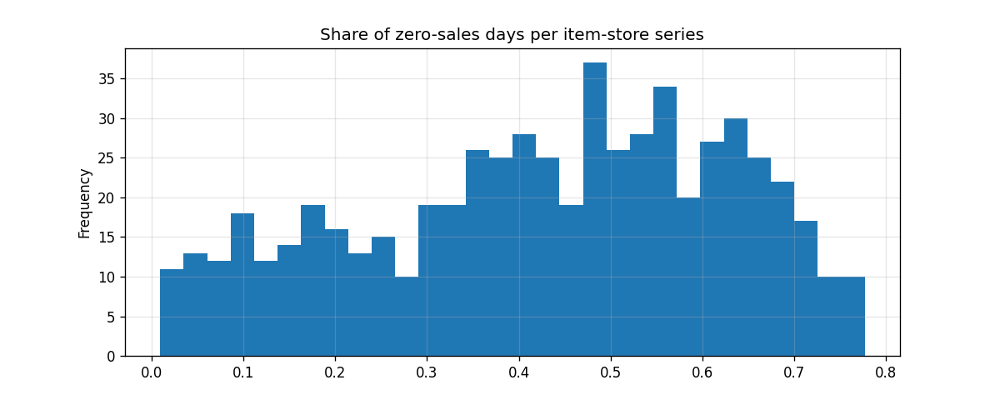
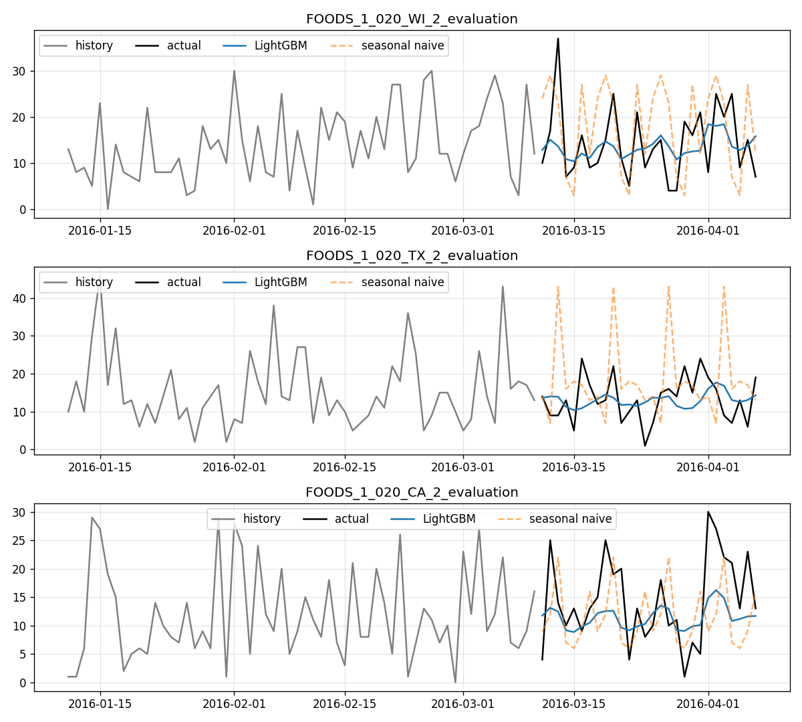
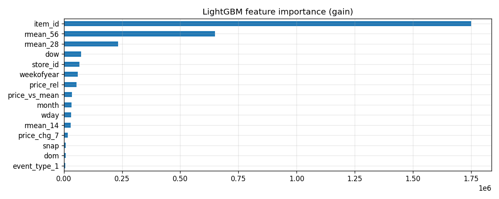
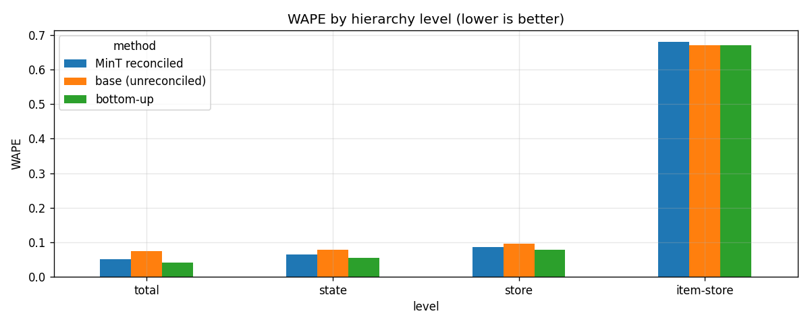
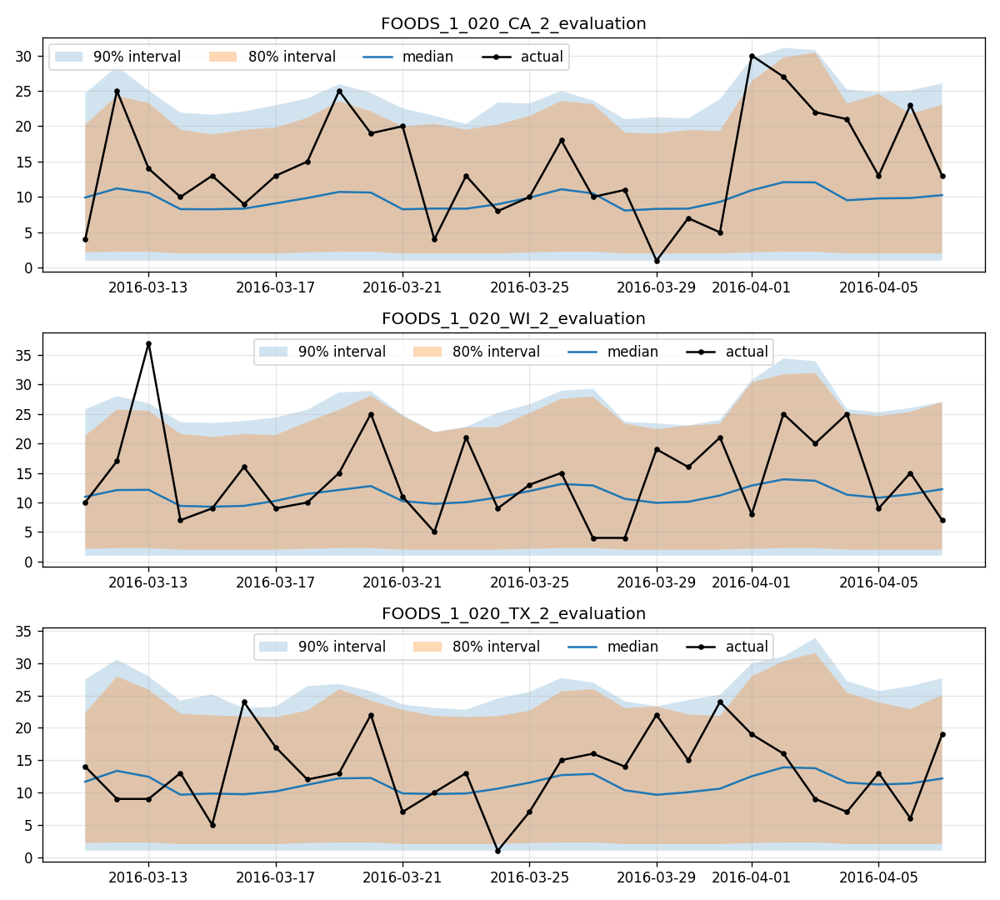
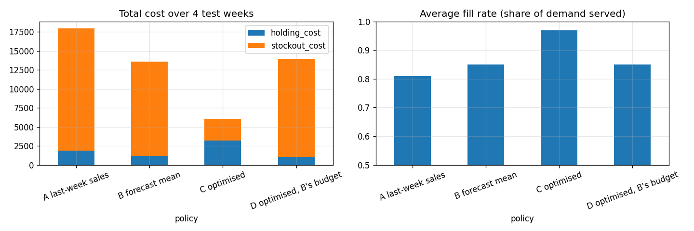
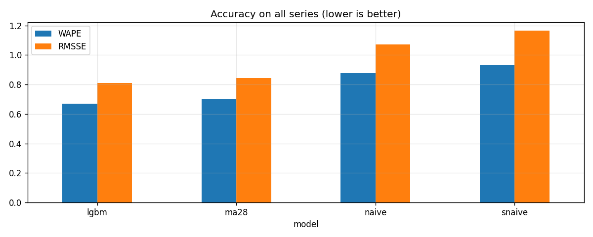

# 📦 Nationwide Demand Forecasting & Inventory Optimization

[](https://www.python.org/)
[](https://lightgbm.readthedocs.io/)
[](https://pytorch.org/)
[](https://developers.google.com/optimization)
[](https://dash.plotly.com/)
[](LICENSE)

An end-to-end Data Science & Operations Research pipeline that:
- Forecasts daily product demand across **nationwide Walmart stores** (M5 dataset)
- Reconciles forecasts across a **6-level hierarchy** (Nation → State → Store → Category → Dept → Item)
- Produces calibrated **prediction intervals** (P10 / P50 / P90)
- Turns forecasts into **optimal replenishment orders** via a Mixed-Integer LP (Google OR-Tools)
- Serves an interactive **Plotly Dash dashboard** for live what-if simulation

> **Data mode.** The 450 MB M5 files are not bundled. If `data/raw/` has no M5 files the code auto-generates an **M5-shaped synthetic dataset** so the full pipeline runs end-to-end. Numbers produced on it validate the pipeline only — re-run on the real Kaggle M5 data before quoting results. `reports/metrics.md` states which mode was used.

---

## 📸 Output Screenshots

### Demand Hierarchy


### Seasonality Analysis


### Price Effect on Demand


### Demand Intermittency


### LightGBM Forecast Examples


### Feature Importance (LightGBM)


### Hierarchical Reconciliation (MinT)


### Prediction Intervals (80% & 90%)


### Inventory Policy Cost Comparison


### Model Comparison Summary


---

## 📊 Key Results (Synthetic Run — re-run on real M5 to validate)

### Point Forecast Accuracy (28-day test window)

| Model    | WAPE  | RMSSE | Scope        |
|----------|-------|-------|--------------|
| **LightGBM** | **0.670** | **0.809** | All 600 series |
| Moving Avg 28 | 0.704 | 0.843 | All 600 series |
| Naive    | 0.876 | 1.072 | All 600 series |
| Seasonal Naive | 0.930 | 1.165 | All 600 series |
| **LightGBM** | **0.483** | **0.835** | Top 40 series |
| Prophet  | 0.526 | 0.892 | Top 40 series |

### Prediction Interval Coverage

| Interval | Target | Coverage | Avg Width |
|----------|--------|----------|-----------|
| 80% raw  | 80%    | 85.6%    | 3.66      |
| 80% calibrated | 80% | 85.6% | 3.66   |
| 90% raw  | 90%    | 93.9%    | 4.60      |
| 90% calibrated | 90% | 93.9% | 4.60  |

### Hierarchical Reconciliation WAPE by Level

| Level      | MinT Reconciled | Base (Unreconciled) | Bottom-Up |
|------------|-----------------|---------------------|-----------|
| Total      | **0.052**       | 0.075               | 0.042     |
| State      | **0.065**       | 0.078               | 0.055     |
| Store      | **0.087**       | 0.096               | 0.079     |
| Item-store | 0.680           | 0.670               | 0.670     |

### Inventory Policies Replayed on 4 Test Weeks

| Policy | Holding Cost | Stockout Cost | Total Cost | Fill Rate |
|--------|-------------|---------------|------------|-----------|
| A. Last-week sales | 1,872 | 16,102 | 17,974 | 81.0% |
| B. Forecast mean | 1,191 | 12,389 | 13,580 | 85.0% |
| **C. OR-Tools optimised** | **3,221** | **2,828** | **6,049** | **97.0%** |
| D. Optimised @ B's budget | 1,080 | 12,826 | 13,905 | 85.0% |

> **Optimised (C) vs Forecast-mean (B):** total cost −55%, fill rate +12 pp, at 1.44× the purchase spend. Policy D shows the optimiser holds its own at the same budget.

---

## 🏗️ Pipeline

| # | Notebook | What it does |
|---|----------|--------------|
| 01 | `01_data_understanding` | Load M5, build 6-level hierarchy (item → store → state → national), subset, save long table |
| 02 | `02_eda` | Seasonality, SNAP food-stamp cycles, events, price effects, intermittency analysis |
| 03 | `03_feature_engineering` | Lags, rolling means, holidays, prices, promo proxy; leakage check; train/valid/test split |
| 04 | `04_baselines_naive_prophet` | Naive, Seasonal Naive, Moving Average 28, Prophet |
| 05 | `05_lightgbm_forecast` | Global LightGBM (Tweedie loss) + feature importance |
| 06 | `06_tft_pytorch_forecasting` | Temporal Fusion Transformer (quantile output) — GPU recommended |
| 07 | `07_hierarchical_reconciliation` | MinT reconciliation: item-store → store → state → total coherence |
| 08 | `08_prediction_intervals` | Quantile LightGBM + conformal calibration (CQR), coverage evaluation |
| 09 | `09_inventory_optimization_ortools` | OR-Tools GLOP LP, 4 policies replayed on real demand |
| 10 | `10_model_comparison` | One results table → `reports/metrics.md` |

Source modules in `src/` (metrics, features, data loader, reconciliation, optimizer) and `app/` are used by both notebooks and the Dash app.

---

## 📁 Repository Structure

```
dfio/
├── app/
│   └── dash_app.py              # Plotly Dash app (forecasts + accuracy + order recommender)
├── data/
│   ├── raw/                     # Place real M5 CSVs here (see below)
│   ├── processed/               # Generated: long.parquet, feature tables
│   └── outputs/                 # Generated: pred_*.parquet, metrics_*.csv, etc.
├── docs/
│   ├── architecture.png         # System architecture diagram
│   ├── data_dictionary.md       # M5 schema & engineered feature reference
│   ├── presentation_outline.md  # 10-minute executive presentation guide
│   └── reflection_TEMPLATE.md  # Individual reflection template
├── models/
│   └── lgbm_global.txt          # Saved LightGBM model (generated by notebook 05)
├── notebooks/
│   ├── 01_data_understanding.ipynb
│   ├── 02_eda.ipynb
│   ├── 03_feature_engineering.ipynb
│   ├── 04_baselines_naive_prophet.ipynb
│   ├── 05_lightgbm_forecast.ipynb
│   ├── 06_tft_pytorch_forecasting.ipynb
│   ├── 07_hierarchical_reconciliation.ipynb
│   ├── 08_prediction_intervals.ipynb
│   ├── 09_inventory_optimization_ortools.ipynb
│   └── 10_model_comparison.ipynb
├── reports/
│   ├── figures/                 # All output charts (PNG)
│   └── metrics.md               # Auto-generated results summary
├── src/
│   ├── __init__.py
│   ├── config.py                # Shared constants: paths, horizon, costs, subset
│   ├── data.py                  # M5 data ingestion & synthetic generator dispatch
│   ├── features.py              # Leak-free lags, rolling stats, SNAP, price features
│   ├── metrics.py               # WAPE, RMSSE, MAE, RMSE, coverage
│   ├── optimizer.py             # Google OR-Tools GLOP LP replenishment solver
│   ├── reconcile.py             # Darts MinT / bottom-up reconciliation
│   └── synthetic_m5.py          # M5-shaped synthetic dataset generator
├── tests/
│   ├── test_features.py         # Leakage-free feature & time-split tests
│   ├── test_metrics.py          # WAPE / RMSSE / coverage unit tests
│   ├── test_optimizer.py        # Budget, capacity, non-negativity, rounding tests
│   └── test_reconciliation.py  # Coherence & residual tests
├── .gitignore
├── README.md
├── requirements.txt
└── run_all.sh                   # Runs notebooks 01-05, 07-10 in order, then pytest
```

---

## ⚙️ Setup

```bash
# 1. Create and activate virtual environment
python -m venv .venv && source .venv/bin/activate   # Python 3.10–3.12

# 2. Install dependencies
pip install -r requirements.txt
```

---

## 📥 Using the Real M5 Data

1. Download from Kaggle ([M5 Forecasting – Accuracy](https://www.kaggle.com/competitions/m5-forecasting-accuracy/data)):
   - `calendar.csv`
   - `sell_prices.csv`
   - `sales_train_evaluation.csv`
2. Place all three in `data/raw/` (delete the `.synthetic` marker file if present).
3. Optionally widen the subset in `src/config.py` → `SUBSET` (more stores / items / days).
4. Run the full pipeline:
   ```bash
   bash run_all.sh
   ```
   > Notebook 06 (TFT) requires `torch` + GPU and is excluded from `run_all.sh` by default. Run it separately:
   > ```bash
   > TFT_SERIES=300 TFT_EPOCHS=20 jupyter nbconvert --to notebook --execute --inplace notebooks/06_tft_pytorch_forecasting.ipynb
   > ```

---

## 🖥️ Run the Dash App

```bash
python app/dash_app.py
# → open http://127.0.0.1:8050
```

The app has three tabs:

| Tab | What you can do |
|-----|-----------------|
| **Forecasts** | Select any level (Total / State / Store / Item-store), toggle models, view history + actuals + 80/90% shaded prediction intervals |
| **Accuracy** | WAPE & RMSSE bar charts per scope, interval coverage table, MinT reconciliation WAPE by level |
| **Order Recommendations** | Pick store, test week, budget %, stockout-cost multiplier → live OR-Tools re-optimisation replayed against actual demand → CSV download |

---

## 🧪 Tests

```bash
python -m pytest tests -q
```

Test coverage:
- **Metrics:** WAPE, RMSSE, coverage correctness
- **Features:** Leakage-free lags (all shifts ≥ 28 days), no target data in train set
- **Time split:** Validation and test windows do not overlap train
- **Reconciliation:** MinT-reconciled forecasts sum coherently at all levels
- **Optimizer:** Budget constraint satisfied, non-negativity, rounding, capacity bounds

---

## 🎯 Design Decisions

| Decision | Rationale |
|----------|-----------|
| **Direct multi-horizon model** | All sales-based features shifted ≥ 28 days → one model forecasts the entire horizon without recursion or leakage |
| **Tweedie objective** | Handles non-negative, zero-inflated demand naturally |
| **Quantile LightGBM + CQR** | Calibrated prediction intervals without distributional assumptions |
| **MinT reconciliation** | Forces store / state / national forecasts to be coherent; eliminates incoherency error to 0.000 units |
| **Scenario-based newsvendor LP** | Demand scenarios sampled from quantile forecasts give the optimizer visibility of uncertainty, not just point estimates |
| **Subset (6 stores, 100 items)** | Full M5 is ~30k series; default slice keeps training tractable — state your subset in any presentation |

Cost parameters (holding rate, stockout goodwill, unit cost ratio) live in `src/config.py` because M5 includes no cost data — they are **explicit assumptions**.

---

## ⚠️ Known Limitations

- **Promotions** are approximated via price-drop proxy; M5 has no promo flag.
- **On-hand inventory** is assumed zero at each replenishment cycle start.
- Days within a cycle are sampled independently, slightly understating weekly variance.
- Reconciliation uses Holt-Winters base forecasts at aggregate levels; strong bottom-level forecasts may beat MinT at the top levels via plain bottom-up.
- At an *equal budget*, the optimiser performed comparably to ordering the forecast mean in the synthetic run; its advantage appeared in the **cost / fill-rate trade-off** when budget is flexible.

---

## 📄 License

[MIT](LICENSE) — see the LICENSE file for details.
